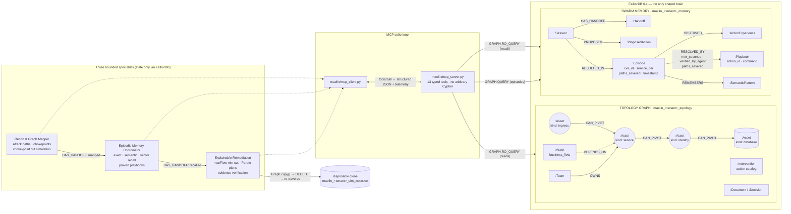

# MAELIN

### Graph-Native Counterfactual Incident Response & Multi-Agent Memory Engine

[](https://github.com/vivekyarra/Graph/actions)
[](LICENSE)
[](https://www.python.org/)
[](https://www.falkordb.com/)
[](https://modelcontextprotocol.io/)
[](docs/CYPHER.md)
[](docs/CYPHER.md)
[](#hackathon-track--architecture-mapping)
[](#hackathon-track--architecture-mapping)

**Simulate before you remediate.** Zero in-memory state, bounded Cypher provenance, provable min-cut isolation, and multi-tenant causal memory powered by native **FalkorDB** graph algorithms.

[Live Interactive Cockpit](https://maelin-graph-hacks-demo.onrender.com) • [Complete Cypher Catalog](docs/CYPHER.md) • [System Verification Guide](docs/evaluation_guide.md) • [Deployment Docs](docs/deployment.md) • [Contributing](CONTRIBUTING.md)

---

## The problem

When a security alert fires, the reflex is to quarantine the compromised service. In a connected system that often causes a self-inflicted outage: take down `auth-service` and checkout, billing and sign-in go with it. Next week someone makes the same call again, because nothing remembers what happened.

## What MAELIN does

MAELIN is an incident-response agent team whose only shared brain is **FalkorDB**.

| | What happens | FalkorDB feature doing the work |
|---|---|---|
| 1 | **Recon** enumerates *every* multi-hop route from the entry point through the compromised asset to the crown jewel, plus every customer flow that depends on each asset | Bounded variable-length Cypher (`CAN_PIVOT*1..7`, `DEPENDS_ON*1..7`) with `nodes(p)` / `relationships(p)` provenance |
| 2 | **Recon** ranks attack chokepoints | Cypher path counting + `algo.betweenness` |
| 3 | **Recon & Remediation** run the *choke-point cut simulation*: how many ingress → service → privileged-identity exploit paths does isolating one service sever? | Bounded `CAN_PIVOT*1..6` traversal + distinct-path aggregation (`paths_severed`, `pct_blast_radius_eliminated`) |
| 4 | **Memory** recalls past outcomes for this incident, a structurally similar one, or a semantically matching pattern | Episode graph + **vector index** (`db.idx.vector.queryNodes`) |
| 5 | **Memory** recalls *proven playbooks* ranked by usage and observed MTTR across sessions | `(:Session)-[:RECORDED]->(:Episode)-[:RESOLVED_BY]->(:Playbook)` aggregation |
| 6 | **Remediation** scores every complete 1–3 action cut, compares *Future A* (quarantine, 160 $k/h impact) with *Future B* (surgical cut, 0 impact), and **proves the cut is minimal** | `algo.maxFlow` min-cut (Menger bound) |
| 7 | Every cited service, CVE-equivalent and role is cross-checked against the nodes FalkorDB actually returned | Deterministic evidence IDs `[E1]…` + set-membership `hallucination_check` |
| 8 | The chosen plan is **replayed on a disposable clone**: real `DELETE`s, real re-traversal, clone deleted | `GRAPH.COPY` via `Graph.copy()` |
| 9 | The operator reports the outcome. It becomes an episode **and** a postmortem document; the next session picks a different plan | Memory graph writes + Company Brain documents |
| 10 | Anyone can ask "is it safe to quarantine auth-service?" and get an answer **with sources**: runbooks, postmortems, owners, on-call, decisions | **Full-text index** (`db.idx.fulltext.queryNodes`) + ownership/decision traversal |

Agents never pass state in Python. Each specialist reads the previous one's work from immutable `(:Session)-[:HAS_HANDOFF]->(:Handoff)` nodes, and every graph read goes through **real MCP stdio tool calls** (`maelin/mcp_server.py`, 13 typed, parameterized tools). Remove FalkorDB and nothing works: the API fails closed with HTTP 503.

Reconnaissance is read-only *at the protocol level*: every agent read executes as **`GRAPH.RO_QUERY`**, which FalkorDB rejects if the statement would write. Writes (`seed.py`, outcome memory) use `GRAPH.QUERY`. Each query returns a `telemetry_trace` row with its server-reported `run_time_ms`, the target graph, the agent and its evidence ID — rendered live in the cockpit's execution-trace drawer.

---

## Capability Matrix & Architecture

| Architectural Domain | Core Technical Objectives | Interactive Demonstration & Verification |
|---|---|---|
| **Autonomous Graph Agents** *(Connected Data)* | Multi-hop reasoning, native graph algorithms as agent tools, MCP tool selection, actions grounded in graph topologies, explainable results | **Investigate** → 2 routes with hop provenance; HUD chips for `algo.maxFlow`, chokepoints and `algo.pageRank`; **Replay** cuts edges on a clone (2 → 0 routes); **Cypher** button inspects generated queries |
| **Agent Memory & State Coordination** *(Episodic, Semantic & Procedural)* | Multi-layered episodic, semantic and procedural memory; persistent history; zero-in-memory handoffs; tenant-scoped isolation; high concurrency | Report an outage → **New session** → decision dynamically adapts with causal with/without-memory ablation banner. **Memory** tab: sessions, episodes, exact/semantic/vector recall, handoff ledger. Multi-tenant graph isolation |
| **Company Brain & Knowledge Subgraph** *(Organizational Intelligence)* | Unified enterprise knowledge graph mapping services, revenue flows, teams, and postmortems; cited question answering; live ownership graph | **Brain** tab: ask domain questions with citation grounding. Interactive node inspection for service owners, on-call engineers, ADRs, postmortems, and blast radius |

---

## Architecture: two graphs, three agents, one MCP loop



Every arrow between agents is a **persisted graph handoff**, not a Python argument.
Every arrow into FalkorDB is a **parameterized Cypher query** whose server-side
`run_time_ms` is surfaced in the cockpit telemetry drawer. The complete query
catalog, per-agent grouping and FalkorDB 6.x syntax rules are in
**[docs/CYPHER.md](docs/CYPHER.md)**.

---

## Graph data model

Two graphs per tenant: `maelin_{tenant}_topology` (infrastructure + company brain) and `maelin_{tenant}_memory` (agent memory).

```
TOPOLOGY GRAPH
(:Asset {id, kind, role, value, critical})
(:Asset)-[:CAN_PIVOT {edge_id, evidence, cap}]->(:Asset)        attack surface
(:Asset {kind:'business_flow'})-[:DEPENDS_ON]->(:Asset)           customer impact
(:Intervention {id, label, blocked_nodes, blocked_edges, cost})   action catalog
(:Team)-[:OWNS]->(:Asset)
(:Person {on_call})-[:MEMBER_OF]->(:Team)
(:Document {kind: runbook|postmortem|adr|ticket|chat})-[:ABOUT]->(:Asset)
(:Document)-[:AUTHORED_BY]->(:Person)
(:Decision)-[:DECIDED_BY]->(:Person)
(:Decision)-[:SOURCED_FROM]->(:Document)
(:Decision)-[:AFFECTS]->(:Asset)
(:GraphMetadata {source, vulnerable, target, fingerprint})

MEMORY GRAPH
(:Session)-[:HAS_HANDOFF]->(:Handoff {agent, status, payload})    agent coordination
(:Session)-[:HAS_TURN]->(:ConversationTurn)                       conversation history
(:Session)-[:PROPOSED]->(:ProposedAction)
(:Session)-[:RECORDED]->(:Episode)  (alias of RESULTED_IN, used by playbook recall)
(:Episode {episode_id, cve_id, service_tier, paths_severed,
           blast_radius_score, timestamp, embedding})-[:OBSERVED]->(:ActionExperience)   episodic
(:Episode)-[:RESOLVED_BY {mttr_seconds, verified_by_agent,
                          paths_severed}]->(:Playbook {action_id, command, description})   procedural
(:IncidentPattern)-[:HAS_EPISODE]->(:Episode)
(:IncidentPattern)-[:HAS_PROCEDURE]->(:Procedure)-[:SUPPORTED_BY]->(:ActionExperience)
(:SemanticPattern)-[:REMEMBERS]->(:Episode)                        semantic
```

**Indexes** (created at seed): range indexes on `Asset.id`, `Team.id`, `Person.id`, `Document.id`, `Intervention.id`, `Session.id`, `Episode.id`, `IncidentPattern.fingerprint`; a full-text index on `Document(title, body)`; a cosine vector index on `Episode.embedding`.

---

## Core Cypher queries and graph algorithms

### 1. Every attack route through the compromised asset, with hop-by-hop provenance (`store.py`)
```cypher
MATCH p=(s:Asset {id:$source})-[:CAN_PIVOT*1..7]->(t:Asset {id:$target})
WITH p WHERE ANY(n IN nodes(p) WHERE n.id = $vulnerable)
RETURN [n IN nodes(p) | n.id] AS assets,
       [r IN relationships(p) | r.edge_id] AS pivots,
       [r IN relationships(p) | r.evidence] AS edge_evidence,
       nodes(p) AS path_nodes,
       relationships(p) AS path_relationships LIMIT 257
```
`shortestPath()` would miss a dangerous longer route when a benign shortcut exists. Over 256 routes, MAELIN refuses to conclude rather than truncate.

### 2. Proven minimum cut: `algo.maxFlow` (`store.py`)
```cypher
MATCH (s:Asset {id:$vulnerable}), (t:Asset {id:$target})
CALL algo.maxFlow({sourceNodes:[s], targetNodes:[t], capacityProperty:'cap',
                   nodeLabels:['Asset'], relationshipTypes:['CAN_PIVOT']})
YIELD edges, edgeFlows, maxFlow
```
With unit capacities, max-flow equals the minimum number of pivots that must be cut (Menger's theorem). The residual graph yields a concrete cut (`p3 + p5`), and the UI marks the recommended plan **Proven minimal** when it matches.

### 3. Attack chokepoints (`store.py`)
```cypher
MATCH p=(:Asset {id:$source})-[:CAN_PIVOT*1..7]->(:Asset {id:$target})
WITH p LIMIT 257
WITH collect(p) AS paths
WITH paths, size(paths) AS total
UNWIND paths AS p UNWIND nodes(p)[1..-1] AS n
RETURN n.id, count(*) AS routes, total ORDER BY routes DESC
```
plus `CALL algo.betweenness({nodeLabels:['Asset'], relationshipTypes:['CAN_PIVOT'], samplingSize:4096, samplingSeed:42})`.

### 4. Customer dependency and blast radius (`store.py`)
```cypher
MATCH p=(f:Asset)-[:DEPENDS_ON*1..7]->(s:Asset) WHERE f.kind='business_flow'
RETURN f.id, f.value, [n IN nodes(p) | n.id], nodes(p), relationships(p) LIMIT 1025
```

### 5. Disposable clone replay (`simulator.py`)
```cypher
// on maelin_{tenant}_sim_{uuid4().hex[:8]}, created with Graph.copy(), deleted in finally
MATCH ()-[r:CAN_PIVOT {edge_id:$edge_id}]->() DELETE r;
MATCH (n:Asset {id:$node_id}) DETACH DELETE n;
```
then query 1 is re-run on the clone.

### 6. Memory recall: exact, semantic and vector (`store.py`)
```cypher
MATCH (p:IncidentPattern {fingerprint:$fingerprint})-[:HAS_EPISODE]->(e:Episode)-[:OBSERVED]->(a:ActionExperience)
RETURN a.action_id, a.outcome, a.cost_observed, e.id;

CALL db.idx.vector.queryNodes('Episode', 'embedding', $k, vecf32($vec)) YIELD node, score
MATCH (node)-[:OBSERVED]->(a:ActionExperience)
RETURN a.action_id, a.outcome, score
```
The embedding encodes the kinds of the entry point, the compromised pivot and the target. A structurally similar incident (e.g. entry via a service instead of the internet) is recalled with a similarity-discounted weight.

### 7. Company Brain answer with sources (`brain.py`)
```cypher
CALL db.idx.fulltext.queryNodes('Document', $q) YIELD node, score RETURN node.id, node.title, score;

MATCH (t:Team)-[:OWNS]->(a:Asset) WHERE a.id IN $ids
OPTIONAL MATCH (p:Person {on_call:true})-[:MEMBER_OF]->(t)
RETURN a.id, t.name, t.lead, collect(p.name);

MATCH (d:Decision)-[:SOURCED_FROM]->(src:Document), (d)-[:DECIDED_BY]->(p:Person)
RETURN d.title, p.name, src.title
```
Ownership is the `(:Team)-[:OWNS]->(:Asset)` subgraph; `CALL algo.pageRank('Asset', 'DEPENDS_ON')` ranks the most depended-on assets.

---

## Quickstart & Startup Options

### Fastest path (3 commands, from a clean clone)

```bash
docker compose up -d --build
docker compose exec app python -m maelin.seed --tenant alpha
docker compose exec app python -m maelin.seed --tenant beta
```

Open **http://localhost:8000** for the cockpit and **http://localhost:3000** for the
FalkorDB Browser. The cockpit is static HTML/JS served by the FastAPI process — there
is no separate frontend build step (`static/` is mounted at `/assets`).

Running on the host instead of Compose:

```bash
docker compose up -d graph
python -m venv .venv && source .venv/bin/activate
pip install -r requirements.txt
python -m maelin.seed --tenant alpha --reset
uvicorn maelin.api:api --host 0.0.0.0 --port 8000
```

### Option 1: Standalone Demo Container (All-in-One FalkorDB + App)
Spins up FalkorDB and the FastAPI application in a single container with synthetic tenants (`alpha`, `beta`) auto-seeded on boot:
```bash
docker build -f Dockerfile.demo -t maelin-demo .
docker run -p 8000:8000 -e MAELIN_PUBLIC_DEMO=1 maelin-demo
```
Access the interactive cockpit at **http://localhost:8000**.

### Option 2: Docker Compose (Dedicated FalkorDB + App Services)
Launches the official FalkorDB service and builds the application container with MCP stdio tools enabled:
```bash
docker compose up -d --build
docker compose exec app python -m maelin.seed --tenant alpha
docker compose exec app python -m maelin.seed --tenant beta
```
Access the cockpit at **http://localhost:8000** and the FalkorDB Browser at **http://localhost:3000**.

### Option 3: Local Python Virtual Environment
Run directly on the host against a local or containerized FalkorDB instance:
```bash
# 1. Start FalkorDB container (if not already running)
docker run -d -p 6379:6379 -p 3000:3000 --name falkordb falkordb/falkordb:latest

# 2. Create and activate a Python 3.11+ virtual environment
python -m venv .venv
# On Linux/macOS:
source .venv/bin/activate
# On Windows PowerShell:
.\.venv\Scripts\activate

# 3. Install dependencies and seed demo graphs
pip install -r requirements.txt
python -m maelin.seed --tenant alpha
python -m maelin.seed --tenant beta

# 4. Start the FastAPI server
uvicorn maelin.api:api --host 0.0.0.0 --port 8000
```
Access the cockpit at **http://localhost:8000**.

### Interactive Verification Walkthrough (60-Second Flow)
1. **Investigate** (or press ↵): watch the agents and MCP calls, then hover **Future A** and **Future B** to preview them on the graph.
2. **Replay B on a graph clone**: the cut edges are marked and the routes go from 2 to 0.
3. Click **Caused outage** on *Revoke admin role*, then **New session**: memory changes the decision, and the ablation banner shows why.
4. **Brain** tab: ask *"What happened when we revoked the admin role?"*. The new postmortem is cited. Click any node for owners and on-call.
5. Press **⌘K → Inject shadow route**, then **Re-test old plan**: it now fails on a fresh clone, and re-investigating finds the 3rd route.

Keyboard: `⌘K` commands · `↵` investigate · `1`/`2`/`3` tabs · `/` ask the brain · `Esc` clear.

---

## Deployment & Security Invariants

* **Constant-Time Operator Authentication**: Remote deployments configure `MAELIN_OPERATOR_TOKEN`. Every graph operation requires the `x-maelin-operator-token` header, verified via `hmac.compare_digest` to eliminate timing side-channel attacks. Well-known tokens (`demo`, `admin`, `judge`) are strictly rejected when a token is configured.
* **Public Demo Boundary**: Setting `MAELIN_PUBLIC_DEMO=1` permits tokenless access **exclusively** to the synthetic demo tenants (`alpha` and `beta`). Custom tenant ingestion or scenario uploads (`/__upload__`) always require valid operator credentials.
* **Strict Tenant Catalog Segregation**: Tenant identifiers are strictly validated against `^[a-z][a-z0-9_-]{0,31}$`. Each tenant is isolated into discrete FalkorDB graphs (`maelin_{tenant}_topology` and `maelin_{tenant}_memory`), mathematically preventing cross-tenant information leakage.
* **Fail-Closed Runtime Architecture**: When FalkorDB is unreachable, all graph-dependent endpoints immediately return `HTTP 503 Service Unavailable`. MAELIN contains zero in-memory or relational graph fallbacks in production runtime code.
* **Bounded MCP Tool Boundary**: The FastMCP server (`maelin/mcp_server.py`) defines 11 typed, parameterized tools with scalar arguments. It exposes no arbitrary Cypher execution tools (`no execute_cypher`, `no query_write`), preventing model hallucinations from executing unsanctioned database operations.
* **Counterfactual Clone Lifecycle**: Simulations occur exclusively on temporary database clones (`maelin_{tenant}_sim_{uuid}`) created via `Graph.copy()` and deallocated in an unconditional `try...finally` block, ensuring operational graphs remain completely immutable.
* **Production Deployment**: Pre-configured for Render deployment via `render.yaml` and `Dockerfile.demo` ([Live Demo](https://maelin-graph-hacks-demo.onrender.com)). External FalkorDB Cloud configurations are supported via `FALKOR_HOST`, `FALKOR_PORT`, `FALKOR_PASSWORD`, and `FALKOR_SSL=1`.
* **Advisory LLM Decoupling**: Optional language models (`OPENAI_API_KEY` / `GEMINI_API_KEY` / Ollama via `MAELIN_LLM_BASE_URL`) operate strictly in an advisory capacity over graph-verified candidates. When unconfigured, MAELIN operates deterministically via native graph algorithms.

---

## Tests and Empirical Verification

```bash
# Install development dependencies
pip install -r requirements-dev.txt

# 1. Execute offline test suite (83 passed, 13 skipped live integration, 0 failures)
python -m pytest -q

# 2. Execute full suite with live FalkorDB integration (all 96 tests)
FALKOR_INTEGRATION=1 python -m pytest -q

# 3. Run empirical cold-start -> replay -> memory adaptation proof
python -m maelin.verify --output verification-proof.json

# 4. Run headless Chromium E2E browser journey (CLS = 0, accessibility verification)
python tests/e2e_real_browser.py
```

### Automated Test Suite Inventory (96 Tests across 14 Modules)
| Test Module | Tests | Focus Area |
|---|---|---|
| `test_invariants.py` | 6 | Verifies zero in-memory fallback graphs in runtime and absence of arbitrary Cypher tools in MCP server. |
| `test_hardening.py` | 9 | Verifies constant-time token authentication, public demo scoping, tenant parameterization, and query bounds. |
| `test_simulation.py` | 7 | Verifies `Graph.copy()` lifecycle, clone namespacing, `try...finally` deletion, and live graph immutability. |
| `test_logic.py` | 10 | Verifies deterministic Pareto optimization kernel and candidate cut evaluation. |
| `test_stress.py` | 1 | Property-based oracle over 5,000 synthetic random DAGs verifying Cypher correctness against mathematical traversal oracle. |
| `test_upgrades.py` | 12 | Verifies `algo.maxFlow`, `algo.pageRank`, `algo.betweenness`, and vector index schemas. |
| `test_agent_proofs.py` | 10 | Verifies choke-point cut math, `RO_QUERY`-only recon, evidence-ID assignment, the hallucination guard, GraphBLAS telemetry and cross-session playbook ranking. |
| `test_judge_proofs.py` | 8 | Validates cold-start threat reconnaissance, memory adaptation, and counterfactual simulation proofs. |
| `test_agents.py` | 4 | Verifies multi-agent pipeline separation and durable graph handoff persistence. |
| `test_brain_offline.py` | 8 | Verifies Company Brain full-text search, asset ownership queries, and document provenance. |
| `test_incident_selection.py` | 6 | Validates scenario selection and graph metadata context. |
| `test_scenario_upload.py` | 9 | Verifies custom scenario upload validation and schema enforcement. |
| `test_reasoner.py` | 3 | Verifies graceful degradation when LLM is unavailable and fallback advisory synthesis. |
| `test_live_falkordb.py` | 6 | Live FalkorDB Cypher traversal, algorithm execution, and clone lifecycle (gated on `FALKOR_INTEGRATION=1`). |
| `test_live_graph_intel.py` | 7 | Live vector index search, semantic recall, and Company Brain full-text search (gated on `FALKOR_INTEGRATION=1`). |

CI (`.github/workflows/falkordb-integration.yml`) executes the entire suite against an official FalkorDB container and publishes verification proofs, screenshots, and browser traces as workflow artifacts.

For formal mathematical proofs and evaluation methodology, see the [System Verification & Evaluation Guide](docs/evaluation_guide.md). For development setup and contribution standards, see [CONTRIBUTING.md](CONTRIBUTING.md). For security policies, see [SECURITY.md](SECURITY.md).

All data is synthetic. MAELIN never touches real infrastructure; recommendations are bounded to the modeled graph and are not a real-world safety certificate.

---

## Hackathon Track & Architecture Mapping

MAELIN addresses three core technical capability domains for **Graph Hacks 2026 (WeMakeDevs × FalkorDB)**:

| Track | What the judges can verify | Where it lives |
|---|---|---|
| **Track 01 — Agents That Act on Connected Data** | Multi-hop Cypher traversals (`nodes(p)`, `relationships(p)`), native `algo.maxFlow` min-cut, `algo.pageRank` dependency centrality, `algo.betweenness`, and the **choke-point cut simulation** (`paths_severed`, `pct_blast_radius_eliminated`) wired into the Remediation narrative | `maelin/store.py` · `find_critical_chokepoints` · `GET /api/chokepoints` · [docs/CYPHER.md](docs/CYPHER.md) §1.4 |
| **Track 02 — Agent Memory and Coordination** | Episodic, semantic, vector and **procedural playbook** memory; zero in-memory handoffs; tenant-isolated causal policy ablation; `(:Episode)-[:RESOLVED_BY]->(:Playbook)` recall ranked by usage and MTTR | `maelin/store.py` · `recall_proven_playbook` · `GET /api/playbooks` · [docs/CYPHER.md](docs/CYPHER.md) §2 |
| **Track 03 — Company Brain** | Unified enterprise knowledge graph mapping services, revenue flows, and engineering teams with cited natural-language retrieval | `maelin/brain.py` · `GET /api/brain/ask` |

### Cross-cutting proof surface

| Capability | Evidence |
|---|---|
| Protocol-level read-only reconnaissance | `Store._ro` → `GRAPH.RO_QUERY` on every agent read; writes isolated in `Store._rw` |
| Anti-hallucination guard | deterministic `[E1]…` IDs + `hallucination_check` (`verified`, `verified_nodes`, `unverified_nodes`) in `/api/investigate`; UI badge **Verified by FalkorDB Graph Proof** |
| Sub-millisecond graph telemetry | `telemetry_trace` rows with `graph_name`, `agent_name`, `query_type`, `cypher`, `run_time_ms`; cockpit **FalkorDB Execution Trace** drawer |
| FalkorDB 6.x / injection hardening | `shortestPath` only inside `WITH`/`RETURN` with directed, bounded hops; zero f-string interpolation (relationship types are static constants); every user-influenced value is a named parameter |
| Complete query catalog | [docs/CYPHER.md](docs/CYPHER.md) — per-agent, per-graph, with rationale and measured latency |

