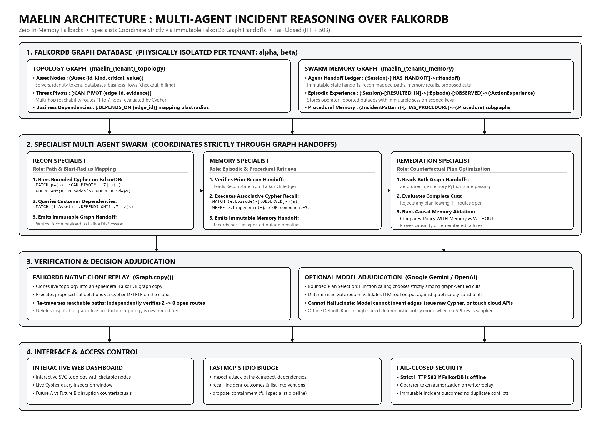

# Maelin — See what breaks before you fix it. Remember what happened last time.

> **Graph Hacks Hackathon Submission** (WeMakeDevs × FalkorDB)  
> **Tracks Entered:** Track 01 (Connected Data) & Track 02 (Agent Memory and Coordination)  
> **Live Demo Cockpit:** [https://maelin-graph-hacks-demo.onrender.com](https://maelin-graph-hacks-demo.onrender.com)

---

## The Problem
When a security alert fires, the standard response is emergency containment—quarantine or shut down the compromised service. But in modern distributed architectures, that often causes an immediate self-inflicted outage (for example, taking down an authentication service breaks checkout and billing).

Worse, AI agents often repeat the exact same operational mistake next week because they have no persistent memory of previous containment outcomes.

## What Maelin Does
Maelin is an incident-response decision engine built on **FalkorDB**:
1. **Discovers all multi-hop attack routes:** Uses Cypher graph traversal to find every privilege path connecting an entry point to sensitive data through a compromised component, while separately mapping customer business dependencies.
2. **Evaluates two counterfactual futures:** Compares **Future A** (emergency quarantine = high business outage) against **Future B** (surgical graph cut = zero customer impact).
3. **Replays actions on disposable graph clones:** Uses FalkorDB's native `Graph.copy()` to clone the topology, execute candidate edge/node cuts in Cypher, re-traverse the modified clone, and verify that 100% of attack paths are severed before recommending an intervention.
4. **Remembers past outages across sessions:** When an operator reports that an intervention caused an unexpected outage, Maelin persists the outcome in an isolated FalkorDB memory graph (`Episode -> ActionExperience`). In future sessions, Maelin automatically penalizes that action and recommends a safer alternative.

---

## Why FalkorDB is Indispensable (Rule #3 Litmus Test)
* **Zero in-memory fallbacks:** Production code has no local JSON, NetworkX, or in-memory graph traversal fallbacks.
* **Fails closed:** If FalkorDB is offline or unreachable, the API immediately returns **HTTP 503**. 
* **Native Graph Clone & Replay:** Disposable simulations mutate isolated FalkorDB graph clones directly in Cypher, leaving the live topology untouched.

---

## How It Solves Both Tracks

| Track | What FalkorDB Powers | How to Verify It |
|---|---|---|
| **Track 01: Connected Data** | Multi-hop Cypher queries (`CAN_PIVOT*1..7` & `DEPENDS_ON*1..7`) find dangerous paths that `shortestPath()` misses due to benign shortcuts. Evaluates surgical graph cuts against customer blast radius. | Click **Investigate**. See two independent attack routes. Run **Replay** to see FalkorDB cut edges on a clone and reduce remaining paths from 2 to 0. |
| **Track 02: Agent Memory & Coordination** | Specialists (`Recon`, `Memory`, `Remediation`) coordinate via immutable `Session -> Handoff` nodes in FalkorDB. Episodic and procedural memory penalizes failed actions across sessions. | Click **Report unexpected outage** on an action → start a **New Session** → recommendation switches to a safer alternative. Switch tenant (`alpha` vs `beta`) to verify strict isolation. |

---

## Architecture & Multi-Agent Flow



---

## Quickstart

### Option A: Try It Live (Zero Setup)
Test the deployed FalkorDB cockpit directly in your browser:
* **Live Demo Cockpit:** [https://maelin-graph-hacks-demo.onrender.com](https://maelin-graph-hacks-demo.onrender.com) (Pre-seeded with Tenant Alpha & Beta)

### Option B: Run Locally with Docker (2 Minutes)
```bash
docker compose up -d --build
```

### 2. Seed the demo tenant graphs
```bash
docker compose exec app python -m maelin.seed --tenant alpha
docker compose exec app python -m maelin.seed --tenant beta
```

### 3. Open the Dashboard
* **Maelin Dashboard:** [http://localhost:8000](http://localhost:8000)
* **FalkorDB Browser:** [http://localhost:3000](http://localhost:3000) (database port: 6379)

---

## Ephemeral Demo Container vs. Persistent FalkorDB Hosting

> **Important Deployment Architecture Note**:
> - **The Public Demo (`Dockerfile.demo`)**: Packages a real FalkorDB server inside Render's ephemeral container alongside FastAPI. This offers instant zero-setup judge evaluation without managing cloud databases, but Render container storage is ephemeral. Each code redeployment or container idle restart resets learned incident history back to the seed baseline.
> - **Continuous Delivery vs. Durable State**: GitHub Actions and Render auto-deploy manage automated code delivery on every push to `main`. However, durable graph memory (persisting `Episode -> ActionExperience` memory graphs and custom tenant uploads across deployments) requires persistent FalkorDB hosting.
> - **Production Deployment (`Dockerfile`)**: Deploy the decoupled `Dockerfile` (or `render.yaml`) connected to an external persistent FalkorDB instance ([FalkorDB Cloud](https://app.falkordb.cloud) or self-hosted FalkorDB with persistent volume storage). Configure `FALKOR_HOST`, `FALKOR_PORT`, `FALKOR_PASSWORD`, and `FALKOR_SSL=1` in your hosting environment variables.
>
> See [DEPLOYMENT_AUTOMATION.md](DEPLOYMENT_AUTOMATION.md) for the complete step-by-step persistent FalkorDB configuration guide.

---

## Core Cypher Queries

### 1. Bounded Multi-Hop Attack Traversal (`maelin/store.py`)
```cypher
MATCH p=(s:Asset {id:$source})-[:CAN_PIVOT*1..7]->(t:Asset {id:$target})
WITH p WHERE ANY(n IN nodes(p) WHERE n.id = $vulnerable)
RETURN [n IN nodes(p) | n.id] AS assets,
       [r IN relationships(p) | r.edge_id] AS pivots LIMIT 257
```
*Why this matters:* `shortestPath()` can be deceived by benign shortcuts that bypass the compromised node. This query guarantees finding all danger paths up to 7 hops.

### 2. Business Dependency Traversal (`maelin/store.py`)
```cypher
MATCH p=(f:Asset)-[:DEPENDS_ON*1..7]->(s:Asset)
WHERE f.kind='business_flow'
RETURN f.id, f.value, [n IN nodes(p) | n.id] LIMIT 1025
```

### 3. Episodic Memory Recall (`maelin/store.py`)
```cypher
MATCH (e:Episode {fingerprint:$fingerprint})-[:OBSERVED]->(a:ActionExperience)
RETURN a.action_id, a.outcome, a.cost_observed, a.evidence_status, e.created, e.id
ORDER BY e.created DESC LIMIT 30
```

---

## Optional LLM Agent Mode (Gemini & OpenAI)

Maelin runs in deterministic policy mode by default. To enable model-powered analytical insight synthesis and function-calling plan adjudication:

```bash
pip install -r requirements-agent.txt

# Set Gemini or OpenAI API key:
export GEMINI_API_KEY="<your-gemini-key>"
# or: export OPENAI_API_KEY="<your-openai-key>"

export MAELIN_USE_LLM=1
```

*Note: The LLM cannot invent graph edges, generate arbitrary Cypher, or execute cloud commands. It strictly analyzes and selects among graph-verified complete plans.*

---

## FastMCP Server

Maelin includes a built-in stdio FastMCP server exposing typed graph tools (`inspect_attack_paths`, `inspect_business_dependencies`, `recall_incident_outcomes`, `list_candidate_interventions`, `propose_containment`):

```bash
python -m maelin.mcp_server
```

---

## Test Suite

```bash
pip install -r requirements-dev.txt
python -m pytest -q
```
* **47 offline and invariant tests pass in ~3 seconds.**
* Includes an exhaustive property-based oracle checking 600 random graph configurations.

